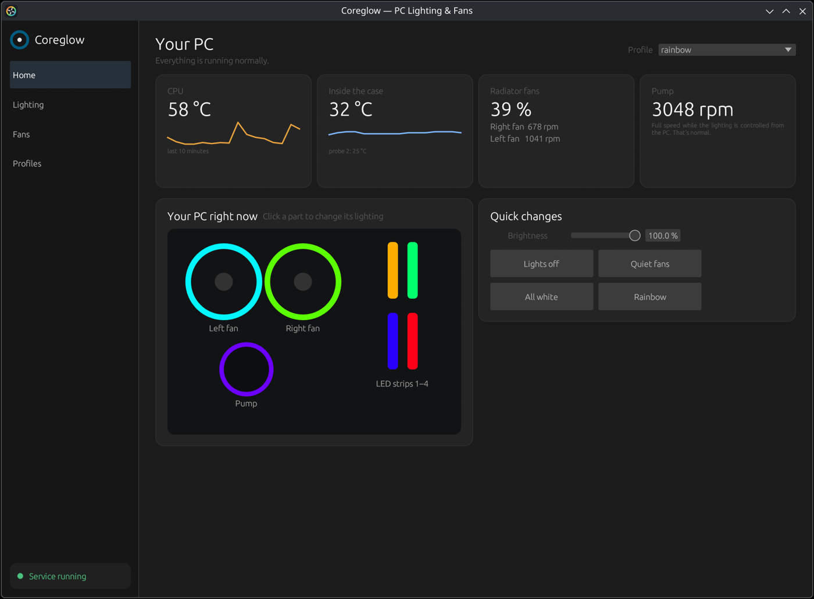
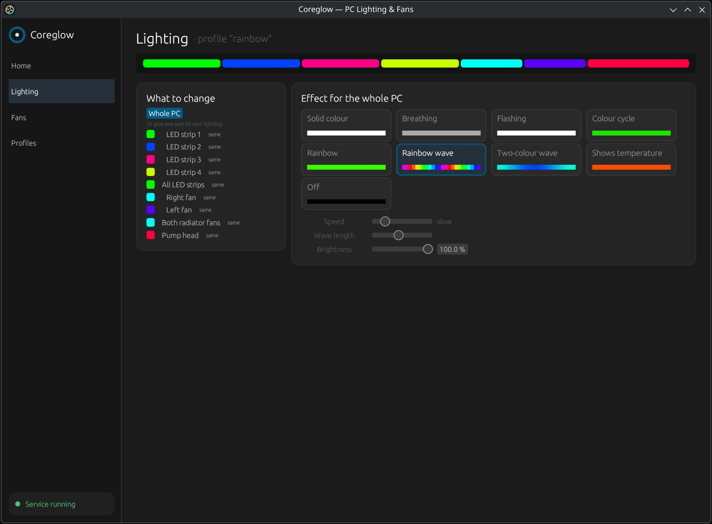
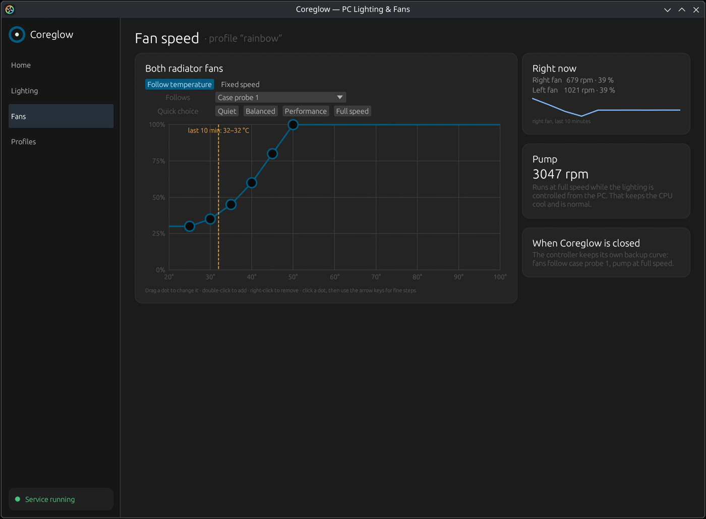
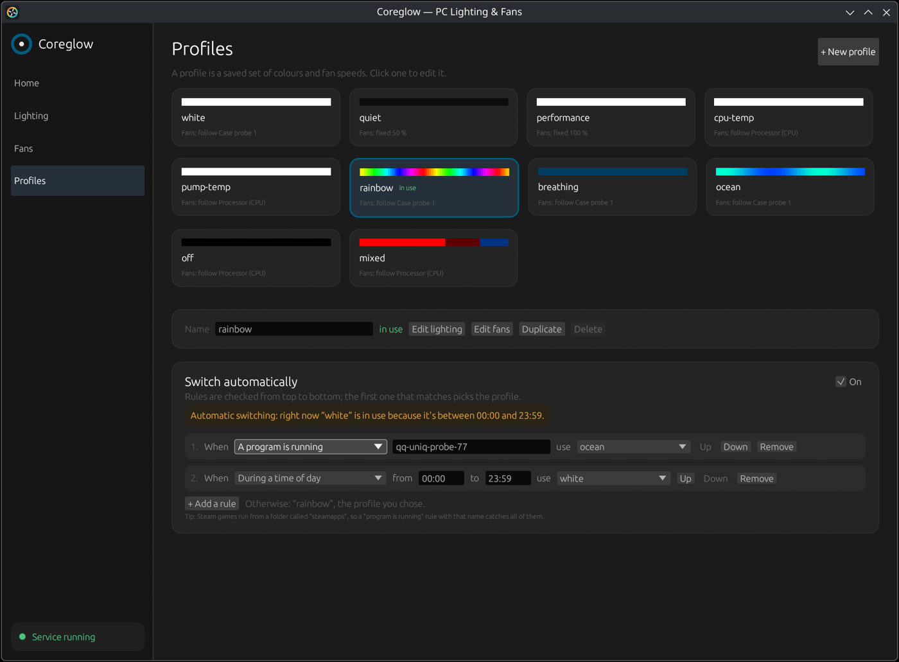

# Coreglow

[](https://github.com/Nexus-SvK/Coreglow/actions/workflows/ci.yml)

Lighting effects, profiles and fan control for the **Corsair iCUE Commander Core XT** on Linux, without iCUE.



| Lighting | Fans | Profiles |
|---|---|---|
|  |  |  |

- `coreglowd`: user service that drives the controller (lighting at ~30 fps, fan duties for fans 1 and 2).
  When it stops, it stores a backup curve in the controller (fans 1 and 2 follow probe 1, pump at 100 %);
  the curve is editable on the Fans page or as `[fallback]` in the config.
- `coreglowctl`: command line: `status`, `list`, `set NAME`, `brightness NAME N`, `auto [on|off]`, `motherboard [on|off]`, `devices`, `test-fans`, `edit`, `fallback`, `gui`.
- `coreglow`: window ("Coreglow" in the app menu) for profiles, effects, per-part lighting, fan curves and
  automatic profile switching (by temperature, running program, time of day or locked screen).
- `coreglow-tray`: tray icon (starts at login) for switching profiles, automatic switching on/off and testing fans.
- Optional motherboard sync through OpenRGB's server, so effects span the whole PC.
- English and Slovak interface (from the system language; `COREGLOW_LANG=en|sk` overrides it). Man pages for all commands.

Profiles live in `~/.config/coreglow/config.toml` (created from `/usr/share/coreglow/config.toml`,
or copied from `~/.config/ccxt/` if you used ccxt-control 0.1,
on first run) and apply within a second of saving.

## Install

Download the `.deb` from the [latest release](https://github.com/Nexus-SvK/Coreglow/releases/latest), then:

    sudo apt install ./coreglow_*_amd64.deb
    systemctl --user start coreglowd

## Build from source

    sudo apt install rustc cargo build-essential pkg-config   # Rust 1.85 or newer (else use rustup)
    packaging/build-deb.sh
    sudo apt install ./target/debian/coreglow_*_amd64.deb
    systemctl --user start coreglowd

## Other builds (experimental)

Without a `[layout]` table Coreglow uses this build's layout. Another build can describe its RGB ports in
`~/.config/coreglow/config.toml`; `coreglowctl devices` shows what the controller detects:

```toml
[layout]
external = ["rgb-strip", "rgb-strip"]       # chain order; LED strips can't be mixed with fans on one port
port1 = ["ql-fan", "ql-fan", "ql-fan"]
port2 = ["pump-cap"]
names = { fans = "port1", pump = "port2", strips = "external" }
```

Device ids: rgb-strip, strip-15/21/27/40/49/84, triangle-9, ll-fan, ml-fan, hd-fan, 8-led-fan, ql-fan, pump-cap.
Without `names`, parts are called external, external1…, port1…, port11…. Profiles may only use part names the
layout has; the file is rejected otherwise, so rename profile parts when you change the layout.

## Hardware notes

- The pump on fan port 6 runs at full speed whenever the lighting is driven from the PC (software mode).
  iCUE behaves the same way.
- The lighting layout (4 LED strips on the external port, fans on ports 1 and 2, pump head on port 3)
  is fixed in `src/zones.rs` for this build.
- GPU temperature needs `nvidia-smi` (NVIDIA's driver); nouveau doesn't report it.

Protocol notes: Bragi file IDs from iCUE's `BragiProtocols.dll`, framing from USB captures and
liquidctl's `commander_core` driver. Lighting needs 384-byte reports.

## Docs

- [docs/icue-reverse-engineering.md](docs/icue-reverse-engineering.md): protocol facts from iCUE captures and binaries.
- [docs/devlog-and-roadmap.md](docs/devlog-and-roadmap.md): how this was built, mistakes, testing checklist, roadmap.

## Upgrading from ccxt-control 0.1

Coreglow was called ccxt-control before 0.2.0 (renamed to avoid a clash with the CCXT trading library).
Installing the coreglow package replaces it; then switch the running service over:

    systemctl --user stop ccxtd
    systemctl --user daemon-reload
    systemctl --user start coreglowd

Profiles are copied from `~/.config/ccxt/` on first start; the old folder is left as it was.

## License

GPL-3.0-or-later. See [LICENSE](LICENSE).

Not affiliated with Corsair. Corsair and iCUE are trademarks of Corsair Memory, Inc.
